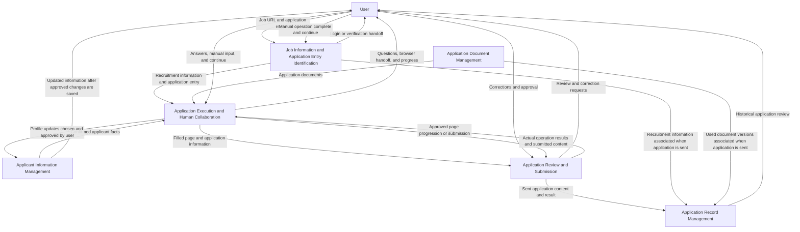

# Apply Pilot Overall Analysis

## 1. Purpose

This document describes the six business modules agreed upon for Apply Pilot. It defines their responsibilities and collaboration at a high level. Detailed data fields, implementation choices, and agent assignments will be addressed during subsequent design.

## 2. Business Modules

### 2.1. Applicant Information Management

**Responsibilities**

- Extract applicant information from PDF files and accept manually entered information.
- Support searching, viewing, adding, modifying, and deleting applicant information.
- Identify duplicate or conflicting information and request user confirmation before making changes.
- Merge entries describing the same experience while preserving different experiences separately.
- Let the user choose whether information supplied during an application updates their stored profile in real time or is used only for that application.
- After the user approves an update and it has been saved, return the updated information for the user to view.

**Boundary**

This module maintains reusable objective facts. Subjective application answers belong in the corresponding application record, rather than the applicant knowledge base. Account information, passwords, and verification codes are excluded from persistent storage according to the requirements.

This module manages data to be entered into application form fields. Application document management manages the files to be uploaded as attachments. A resume may participate in both flows: its original file belongs to document management, while facts extracted from it and confirmed by the user belong to applicant information management.

### 2.2. Application Document Management

**Responsibilities**

- Manage all available files used for job applications, including resumes, cover letters, transcripts, and certificates.
- Support document upload, modification, renaming, version retention, soft deletion, and permanent deletion.
- Keep the document versions used in historical applications available for review, subject to user-approved permanent deletion.
- Update names in associated application records when documents are renamed.
- Select an appropriate resume using its filename and the current job information; ask the user to select or add a resume when selection is uncertain.

**Boundary**

This module manages user-provided documents. The initial scope does not require agents to generate resumes. Selection and usage rules for document types other than resumes will be defined during detailed module design.

This module supplies uploadable attachments rather than the structured applicant information used to fill form fields. Information extraction and confirmation belong to applicant information management.

Soft-deleted documents must not be used in future applications but remain accessible through historical records. Permanent deletion requires informing the user of affected records and obtaining confirmation; affected file references must then be marked as deleted.

### 2.3. Job Information and Application Entry Identification

**Responsibilities**

- Receive a LinkedIn job URL or a recruitment information page on a company website.
- Retrieve the job posting information.
- Use the same browser operation and human handoff mechanism as the application workflow to access recruitment pages. Pause for user login or verification when required, and continue after the user clicks Continue or sends a completion message. Passwords and verification codes must not be recorded, and authenticated access is limited to the current application task.
- Locate the corresponding company's external application entry point.
- Provide the job information and application entry point to the application workflow.
- Inform the user when the posting is unavailable, no entry point can be found, or access fails, and request a decision on how to proceed.

**Boundary**

This module identifies the job and application destination; it does not fill in the application. LinkedIn on-platform applications are excluded. The intended destination scope covers different companies' external application websites without a predefined company or platform restriction. Additional job sources, such as Handshake and Indeed, are deferred.

### 2.4. Application Execution and Human Collaboration

**Responsibilities**

- Operate the browser and identify application fields.
- Fill fields using confirmed information, including certain combinations, splits, and calculations of stored data.
- Obtain applicant information and application documents from their respective modules.
- Ask the user for missing information and user-written answers to non-factual questions.
- Display browser operations and real-time progress in the application workspace.
- Pause for user login, verification, or other manual input, and continue when the user clicks Continue or sends a completion message.
- Stop execution when the user cancels or closes the system page. A closed task cannot be resumed after reopening the page.

**Boundary**

The initial version executes one application at a time. Login credentials are limited to the current task. Passwords and verification codes must not be recorded. Already approved and saved profile changes remain saved after cancellation.

This module performs browser actions; permission to advance through reviewed pages or submit an application belongs to the review and submission module.

### 2.5. Application Review and Submission

**Responsibilities**

- Show the information filled in on each page and obtain user confirmation before advancing.
- Present all completed application information for final review on a new web page or through a PDF export, as selected by the user.
- Accept corrections from the user or allow the user to modify the application website directly.
- Detect direct website changes where possible, with synchronization capabilities to be determined during implementation and testing.
- Require the user to personally confirm declarations and agreement to terms.
- Submit only after explicit user approval.
- Trigger application record saving as soon as the application is sent.
- Interpret the returned result and ask the user about confirmation email receipt when the result is uncertain.

**Boundary**

An uncertain result without a confirmation notification remains pending confirmation. The user may decide whether to apply again. If the website requires further actions after submission, the user must be directed to that page. Detailed submission states will be defined during system design.

The execution module supplies browser operations; this module controls review, approval, and submission decisions. Both may share one application workspace interface.

### 2.6. Application Record Management

**Responsibilities**

- Begin saving a record when an application is sent, without waiting for success confirmation.
- Retain the application date, company name, position, recruitment information, and complete submitted application content, including subjective answers.
- Associate the record with the document versions used for the application.
- Provide historical information for the user to review when preparing for interviews.
- Record confirmed success or pending confirmation as appropriate.
- Preserve sent application records even if the task is subsequently cancelled or the page is closed.

**Boundary**

Historical records retain what was submitted for that application, separately from the reusable applicant knowledge base. Passwords, account information, and verification codes must not be retained. Additional record fields will be determined during detailed design.

Expanded management of interviews, acceptance, and rejection is deferred until the basic functionality is complete.

## 3. Collaboration Principles

- Applicant information management supplies reusable facts; application document management supplies files.
- Job information and entry identification supplies the recruitment context and the external application destination.
- Application execution performs form filling and browser interaction, pausing when user participation is required.
- Review and submission controls page progression and final submission through user approval.
- Application records retain the complete submitted application for later review.
- Application execution returns actual browser operation results and submitted application content to review and submission for result handling and record saving.
- Recruitment information and the document versions used are associated with the historical application record when the application is sent. Retrieving job information or uploading a document alone does not create an application record.
- Saving newly supplied facts to the applicant profile requires the user's choice and approval. Choosing one-time use does not exclude submitted information from its historical application record.

These are business modules, not a requirement for six separate agents or six separately deployed services. Agent responsibilities and the frontend/backend architecture will be defined during architecture design.

## 4. Module Collaboration Diagram

